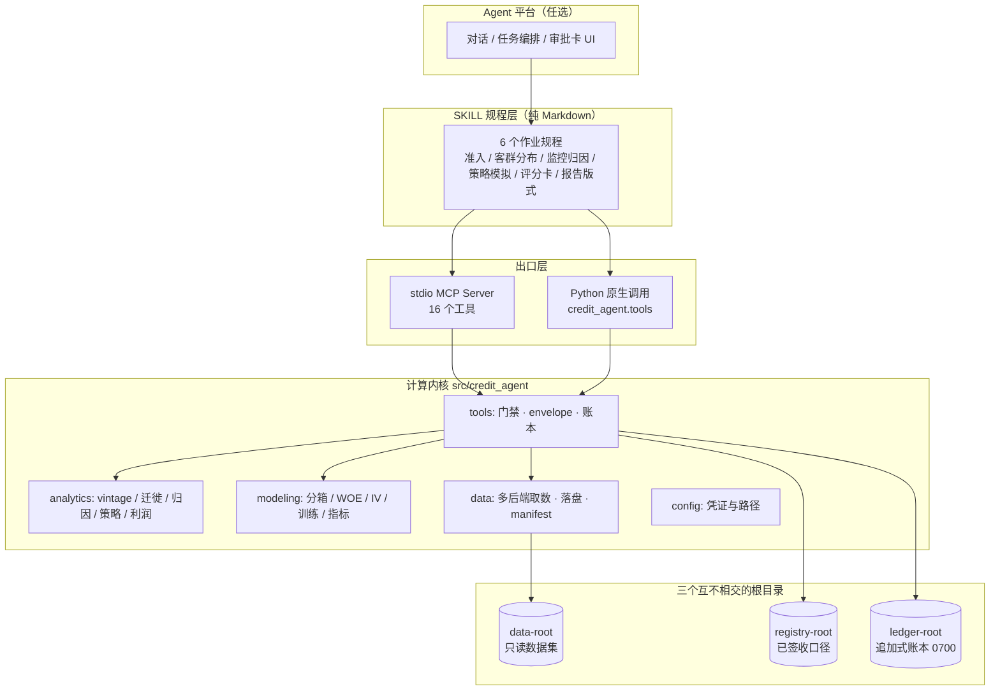

# Credit Risk Agent Core

> 平台无关的信贷策略分析与建模内核。领域计算在 Python 里，能力出口在 MCP 里，作业规程在 SKILL 里——换一个 Agent 平台只需换接入层，计算与规程不动。

[](https://github.com/cadetnicolas/Credit-Risk-Agent-Core/actions/workflows/ci.yml)
[](pyproject.toml)
[](LICENSE)
[](src/credit_agent/mcp_server.py)

信贷分析的工具箱很多，缺的通常不是算法，而是**不让结论跑偏的约束**：口径谁签收的、字段有没有穿越、标签成不成熟、数字对不对得上正文。这个项目把这几件事做成了工具层的硬门禁，然后才在上面提供 vintage、迁徙率、Shift-Share 归因、Cutoff 模拟、WOE 评分卡这些具体能力。

---

## 目录

- [它解决什么问题](#它解决什么问题)
- [四个设计原则](#四个设计原则)
- [架构](#架构)
- [快速开始](#快速开始)
- [接入你自己的平台](#接入你自己的平台)
- [MCP 工具清单](#mcp-工具清单)
- [SKILL 规程包](#skill-规程包)
- [数据与安全边界](#数据与安全边界)
- [目录结构](#目录结构)
- [已知限制](#已知限制)
- [文档索引](#文档索引)

---

## 它解决什么问题

| 常见事故 | 本项目的处理方式 |
| --- | --- |
| 未成熟标签被当成「好客户」进训练集 | `check_label_maturity` 按批次判成熟，未成熟批次不能进分母、不能进训练；要用只能降级为描述性测算，并返回 `degraded` |
| 贷后字段混进特征，AUC 好得离谱 | 口径登记表把列划分成决策时点 / 观察时点，穿越列在绑定快照时就被拦下，返回 `TIME_POINT_VIOLATION` |
| 报告里的坏账率和工具算的不是一个数 | `verify_and_commit_report` 逐条核对 citation，对不上就 `REPORT_UNTRACED`，落不了盘 |
| 模型自己决定「可以上线了」 | 六个关键节点需要宿主写审批卡，Agent 无法自称已批准；未签收就写「建议上线」会 `SIGNOFF_REQUIRED` |
| 换个平台整套重写 | 计算在 `src/credit_agent/`，出口是标准 stdio MCP，规程是纯 Markdown；接入层可替换 |

## 四个设计原则

**1. 准入先行，不是流程建议而是物理前置。** 任何监控、归因、建模、策略模拟之前，必须先拿到合法的 `dataset_snapshot_id` 与成熟度结论。没有准入，后续工具直接 `ADMISSION_REQUIRED`。

**2. 时点隔离是不可协商的红线。** 每个样本有明确的观察时点 $T_0$。$T_0$ 之前冻结的字段才能做特征或归因维度；表现期内的 DPD、催收、还款记录**绝不**作为输入。这条在工具里做，不靠提示词。

**3. 失败必须可解释。** 任何工具失败都返回结构化 envelope（`status` + `block_code` + 说明），不会把裸异常抛到协议通道。`ok` / `degraded` / `needs_human` / `blocked` 四态，每一态都明确规定下游还能做什么。

**4. 人工判断不交给模型。** 验证方式回退、成熟度三项选择、入模特征清单、策略试验、模型签收、异常处置——这六件事由受信任宿主写进同一份追加式账本。`record_human_decision` 刻意**不**注册为 MCP 工具，Agent 没有这个能力。

## 架构



三层职责清晰：**SKILL 决定怎么做（业务方法论）**，**工具决定能不能做（门禁与计算）**，**平台决定谁来做（交互与审批）**。所以换平台只动最上面一层。

## 快速开始

要求 Python ≥ 3.11。

```bash
git clone https://github.com/cadetnicolas/Credit-Risk-Agent-Core.git
cd Credit-Risk-Agent-Core

python3.11 -m venv .venv
source .venv/bin/activate          # Windows: .venv\Scripts\activate

pip install -e '.[mcp,dev]'        # 运行 MCP + 开发测试
```

### 用合成数据跑通整条链路（不接触任何真实业务数据）

```bash
python scripts/make_demo_workspace.py     # 生成 6 个放款批次、后两批故意未成熟
python scripts/demo_end_to_end.py --direct
```

第二条命令会在本地直接拉起 MCP 服务，依次调用「列数据集 → 绑定快照 → 成熟度 → 口径与维度 → 存量监控 → 归因分解」，逐行打印每个 envelope 的 `status`、`block_code` 与关键数字。装坏了、路径错了、数据不对，这一步就会直接报出来。

预期能看到未成熟批次被识别、基期与对比期坏账率的跳变、以及 channel 维度的结构效应 / 组内效应分解。

### 手动启动 MCP 服务

```bash
python -m credit_agent.mcp_server \
  --data-root /absolute/authorized/datasets \
  --registry-root /absolute/signed/metric-registries \
  --ledger-root /absolute/credit-tool-ledger
```

**三个根目录必须两两互不相交。** 账本根若落在数据根内，`list_credit_datasets` 会把含明细的 `frames/*.parquet` 当成数据集列出来，从而绕过准入与成熟度闸门——服务启动时会直接拒绝这种配置。

### 跑测试

```bash
pytest -q
```

覆盖领域计算、MCP 协议握手、审批闭环、发布契约（工具名 / 码表 / SKILL 声明 / 连接器元数据一致性）。

## 接入你自己的平台

按平台能力分三条路，从轻到重：

**A. 标准 MCP 客户端（推荐，零代码）** — Claude Desktop、Cursor、Cline、Continue 以及任何支持 stdio MCP 的客户端，写一段 JSON 即可：

```json
{
  "mcpServers": {
    "credit-risk-analysis": {
      "command": "/absolute/path/to/.venv/bin/python",
      "args": [
        "-m", "credit_agent.mcp_server",
        "--data-root", "/absolute/path/to/datasets",
        "--registry-root", "/absolute/path/to/registries",
        "--ledger-root", "/absolute/path/to/ledger"
      ],
      "env": { "PYTHONPATH": "/absolute/path/to/credit_risk_agent/src" }
    }
  }
}
```

`PYTHONPATH` 与 `pip install -e .` 二选一即可（前者免安装，后者更干净）。

**B. 平台原生工具注册** — 平台没有 MCP 但能注册 Python 函数时，直接导入 `credit_agent.tools` 下的公开函数包装成工具，门禁、envelope、账本逻辑全部复用，只是不走协议层。

**C. 参考现成适配器** — `workbuddy/` 生成连接器 ZIP，`cursor/` 生成本地插件，`codex/` 生成包含 Skill 和 stdio MCP 的本地插件市场。

三条路的详细配置、各客户端差异、逐项验证清单见 **[跨平台接入指南](docs/integration.md)**。

## MCP 工具清单

16 个工具，按分析链路排列。所有工具返回统一 envelope。

| 阶段 | 工具 | 作用 |
| --- | --- | --- |
| 取数 | `download_sample` | 按需求方给定的 SQL 原样取数（只读、单语句、有行数上限、留痕） |
| 取数 | `import_sample_file` | 导入本地 Excel / CSV / Parquet，自动探测编码与分隔符 |
| 准入 | `list_credit_datasets` | 列出数据根下可见数据集 |
| 准入 | `inspect_and_bind_snapshot` | 绑定快照：主键唯一性、时间轴、权重字段、缺失与常量扫描，产出 `dataset_snapshot_id` |
| 准入 | `check_label_maturity` | 表现期成熟度核算，`monthly_cohort`（建模）或 `latest_observed`（策略描述性测算） |
| 准入 | `resolve_metric_and_dimensions` | 读取已签收口径（分子/分母/窗口/版本）与维度登记，划分列角色 |
| 描述 | `describe_population` | 无标签客群分布：先锁定口径（总体/粒度/时点/分母/缺失语义/观察点），再输出全量与分箱构成；标签列一律拒收（0/1 标记列的均值就是坏账率） |
| 描述 | `compare_population_distribution` | 同口径两期比较：分箱百分点变化、分位数差、四项检验各带适用范围与允许结论 |

> 这两个工具的担保是具体的：**未声明的 0/1 列、只剩一侧判定词的列、以及词表内的成对措辞拿不到坏账率；词表外的措辞靠分析者在绑定时用 `column_roles` 声明角色**。字面缺失码（`N/A`、`-`、`未知`）按缺失计，不计入任何一档。
| 监控 | `run_portfolio_monitoring` | 风险趋势、Vintage 曲线、逾期迁徙率 |
| 监控 | `decompose_and_locate_anomaly` | Shift-Share 分解结构与组内效应，定位恶化客群 |
| 建模 | `prepare_modeling_sample` | 划分好坏灰样本，优先时间外（OOT）验证 |
| 建模 | `screen_features` | IV / PSI 筛选，停在人工复核 |
| 建模 | `profile_binning` | ChiMerge 单特征分箱：逐箱样本、坏率、WOE、IV、KS、PSI、合并日志 |
| 建模 | `train_and_evaluate_candidate` | 仅在宿主存有特征审批卡后训练；输出评分卡与指标 |
| 策略 | `simulate_policy_rules` | 单条件规则挖掘 / Cutoff 决策表模拟 / 置换集分析与利润权衡 |
| 报告 | `verify_and_commit_report` | 逐条核对 citation 后落盘；未签收返回 `SIGNOFF_REQUIRED` |

### 返回状态与停机码

| status | 含义 | 下游可做什么 |
| --- | --- | --- |
| `ok` | 通过 | 继续 |
| `degraded` | 部分可用 | 只能做摘要允许的任务，结论需标注局限 |
| `needs_human` | 等人工决策 | 展示选项并等审批卡落账，不自动切换 |
| `blocked` | 阻断 | 写出缺口后停止 |

完整的 `block_code` 码表（含 `LABEL_IMMATURE`、`TIME_POINT_VIOLATION`、`SQL_SCOPE_NOT_AUTHORIZED`、`REPORT_UNTRACED` 等 20 余项）见 [`src/credit_agent/tools/codes.py`](src/credit_agent/tools/codes.py)，这是码表的单一来源，SKILL、MCP 门面、账本与发布契约测试都对齐到它。

## SKILL 规程包

`skills/` 下六个纯 Markdown 规程（v1.6.0，契约 v0.5），任何能加载 SKILL 的 Agent 平台都可直接使用：

| SKILL | 覆盖范围 |
| --- | --- |
| `credit-data-admission` | 数据准入体检、表现期成熟度、字段时点核查、可用范围裁定（Level A/B/C） |
| `population-distribution-analysis` | 无标签客群分布：口径契约、全量分布优先、两期比较与检验口径、结论边界 |
| `portfolio-anomaly-attribution` | 存量资产巡检、同账龄 Vintage、迁徙率、Shift-Share 归因、恶化客群定位 |
| `policy-cutoff-simulation` | 规则挖掘、Cutoff 决策表模拟、置换集分析、边际坏账率与利润权衡 |
| `scorecard-modeling-pipeline` | 评分卡与模型开发，优先 OOT 验证，无法 OOT 时由人选择较弱验证方式 |
| `deliverable-html-report` | 可交付 HTML 报告的版式规范（只定格式，不定业务口径） |

**五个分析规程有明确优先级**：任何监控、归因、策略、建模或无标签分布分析任务都必须先经 `credit-data-admission` 拿到合法快照与成熟度结论，否则其余四个分析规程不得启动。`deliverable-html-report` 是交付规程，不参与这条优先级。

## 数据与安全边界

| 边界 | 规则 |
| --- | --- |
| 数据集 | 只读 CSV / Parquet，单文件 ≤ 100 MiB；不跟随符号链接 |
| 口径登记 | 只读 JSON / YAML，≤ 1 MiB；禁 YAML 锚点与别名（防炸弹） |
| 账本 | 目录 0700、文件 0600，只追加；作为审批证据 |
| 路径逃逸 | 所有模型给出的路径都限制在三个根目录内，绝对路径与 `..` 一律拒绝 |
| 凭证 | 只从环境变量 / 配置页 / `.env` 读取，代码中无硬编码；`.env` 不入库 |
| 多租户 | 一租户一进程，各自独立的 data / registry / ledger 根；不要把凭证或业务数据打包进项目 |
| 取数授权 | `download_sample` 要求 `user_sql` 与 `sql` 逐字一致，改列或改 WHERE 直接 `SQL_SCOPE_NOT_AUTHORIZED` 拒绝执行 |

凭证优先级：`mcp.json` 的 `env` > 配置页 > `.env` > 内置默认。配置页是单文件 HTML，由 `credit-risk-config` 生成并在浏览器里填写保存，适合不想手写配置的场景；`.env` 适合脚本化部署。完整变量清单见 [`.env.example`](.env.example)。

## 目录结构

```text
credit_risk_agent/
├── src/credit_agent/           # 计算内核
│   ├── tools/                  # 门禁、envelope、账本、四类业务工具
│   │   └── codes.py            # status / block_code / gate / 工具名的单一常量源
│   ├── analytics/              # vintage、迁徙、归因、策略、利润、统计
│   ├── modeling/               # 分箱、WOE、IV、训练、指标、评分卡导出
│   ├── data/                   # 多后端取数（duckdb/odps/pg/holo/mysql）、落盘、manifest
│   ├── config/                 # 凭证、路径、配置页
│   ├── render/                 # HTML 报告渲染
│   └── mcp_server.py           # stdio MCP 门面：16 个工具 + 启动期契约自检
├── skills/                     # 6 个 SKILL 规程 + references 方法论
├── workbuddy/                  # WorkBuddy 适配器：连接器元数据、构建脚本、图标
├── cursor/                     # Cursor 适配器：插件清单、构建脚本、图标
├── codex/                      # Codex 适配器：本地插件市场构建脚本
├── scripts/
│   ├── make_demo_workspace.py  # 合成演示工作区
│   ├── demo_end_to_end.py      # 端到端验证（支持任意 MCP 客户端配置或直接启动）
│   ├── config_setup.py         # 生成数据库配置页
│   ├── check_db.py             # 连接与配置自检
│   ├── host_approval.py        # 宿主审批适配器参考实现
│   └── verify_public_datasets.py
├── tools/                      # 可选 ODPS / Hologres / PG 连接辅助（库级，不经 MCP 暴露）
├── tests/                      # 领域计算、MCP 协议、审批闭环、发布契约
├── docs/                       # 接入指南、架构说明、设计文档、历史归档
└── pyproject.toml / LICENSE / .env.example
```

## 已知限制

诚实说明，避免误用：

- **公开数据只能证明代码路径，不能证明业务口径。** `scripts/verify_public_datasets.py` 跑的是 Kaggle 反欺诈与 HELOC 数据，能验证计算与链路，不能替代带真实申请日与表现标签的授权样本。
- **平台兼容性是协议级的。** 仓库交付的完整适配器是 WorkBuddy 与 Cursor。其它 MCP 客户端按标准协议对接，本仓库提供验证脚本而非逐客户端的桌面端认证。
- **`latest_observed` 只做描述性测算。** 该模式返回 `degraded`，所有坏账率、Lift、正式推荐为空，不构成目标表现期坏账率，不得用于建模或上线收益测算。
- **放宽审批后的新增收益不予估算。** 调入集（swap-in）的坏账率本质未知，`simulate_policy_rules` 会明确拒绝这类承诺。
- **LightGBM 是可选依赖**，缺原生 OpenMP 时候选对比返回 `degraded`，不能当作完整双模型比较。
- **数据后端默认 DuckDB**，只适合离线或本地等价数据；接生产数仓需自行安装对应驱动。

## 文档索引

| 文档 | 内容 |
| --- | --- |
| [跨平台接入指南](docs/integration.md) | MCP 客户端配置、原生工具注册、六步验证清单、常见平台差异 |
| [架构说明](docs/architecture.md) | 分层职责、数据流、门禁与账本机制、扩展点 |
| [取数链路设计](docs/sample-acquisition-design.md) | `download_sample` / `import_sample_file` 的契约与边界 |
| [WorkBuddy 接入与打包](docs/workbuddy-skill-mcp-integration-guide.md) | WorkBuddy 适配器的构建与发布细节 |
| [Cursor 接入与打包](docs/cursor-skill-mcp-integration-guide.md) | Cursor 本地插件的构建、安装与自检 |
| [Codex 接入与打包](codex/README.md) | Codex 本地插件市场的构建、安装与更新 |
| [WorkBuddy 安装与使用](docs/workbuddy-install-and-usage.md) | 装好之后的触发时机、数据目录约定、审批 CLI、排障 |
| [功能复核记录](docs/skill-mcp-validation-2026-11-11.md) | 公开数据验证结果与边界 |
| [docs/](docs/) | 文档总索引；历史设计稿在 `docs/archive/`，**不是实现依据** |

## 贡献

见 [CONTRIBUTING.md](CONTRIBUTING.md)。核心一条：**改动业务口径或门禁语义时，必须同步更新 `codes.py`、对应 SKILL、发布契约测试，三者不一致会让 `pytest` 直接失败**——这是故意的。

## License

[MIT](LICENSE)
