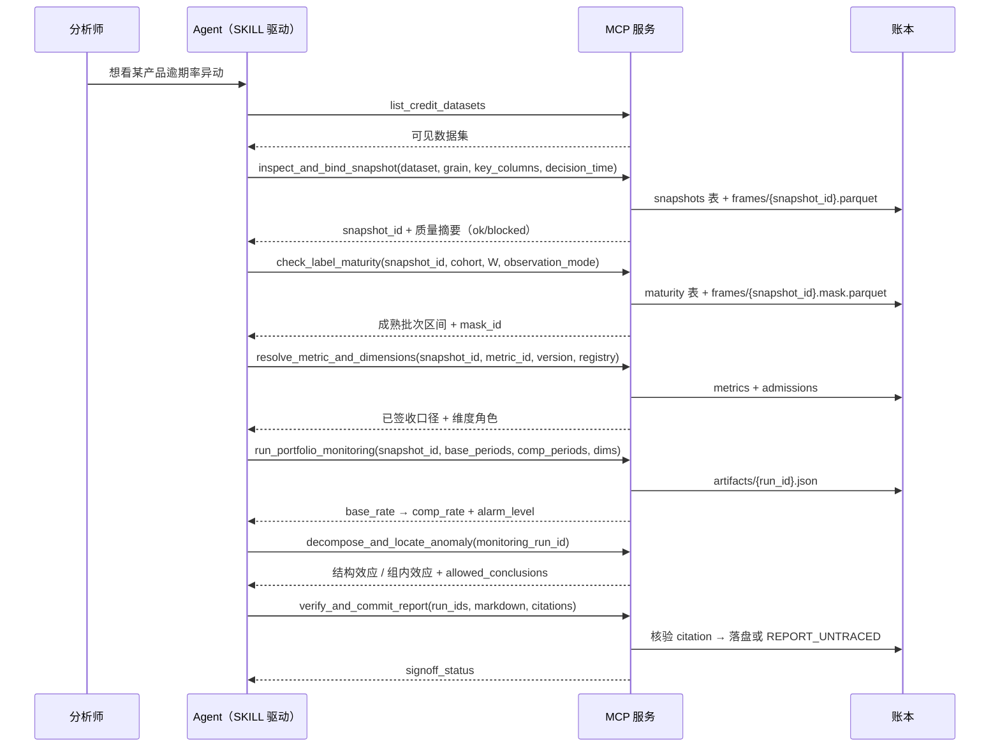

# 架构说明

给要改代码或做深度集成的人看。README 讲「怎么用」，本文讲「为什么这样分层、状态存在哪、门禁在哪生效」。

---

## 一、分层与依赖方向

```text
skills/            Markdown 规程：业务方法论、步骤顺序、停机怎么写
    │  声明 allowed-tools（只是声明，真正的门禁在工具层）
    ▼
mcp_server.py     协议层：路径校验、文件读取、参数清洗、异常转 envelope
    │  注入 ledger / data_root / registry_root
    ▼
tools/            门禁层：准入状态、成熟度、签收、审批、citation 核验
    │
    ▼
analytics/ modeling/ data/    计算层：纯函数，不关心协议与账本
```

依赖只能向下。反过来的依赖是 bug：计算层一旦知道「MCP」或「SKILL」的存在，换平台就得改计算代码。

三个根目录通过构造函数注入，不读全局配置：

```python
create_server(data_root=..., registry_root=..., ledger_root=...)
```

这样单进程内可以起多个隔离实例（测试里就是这么做的），也让「一租户一进程」成为自然选择。

## 二、一次完整分析的数据流



两个细节：

- **明细不进对话。** `frames/*.parquet` 留在账本里，工具只返回计数与摘要。模型看到的是 `mask_id`，不是掩码本身。
- **每一步都落一条 run。** 后续工具引用前一步的 `run_id`，链条断了就无法继续——这是准入前置的物理实现，不是流程约定。

## 三、账本的形状

`--ledger-root` 下有三类东西：

| 路径 | 内容 | 写入方式 |
| --- | --- | --- |
| `ledger.sqlite` | `snapshots` / `maturity` / `metrics` / `admissions` / `runs` / `decisions` / `decision_consumptions` | 每次调用追加或更新对应行 |
| `frames/` | `{snapshot_id}.parquet` 明细、`{snapshot_id}.mask.parquet` 成熟掩码、`{snapshot_id}.latest.parquet` 最新可观察掩码 | 落盘后 `chmod 600` |
| `artifacts/` | `{run_id}.json` 摘要、`{run_id}.{kind}.json` 附加产物 | 先写 `.tmp` 再原子改名 |

`decisions` 表是**追加式**的：同一 `(gate, review_id)` 可以有多行，`get_decision` 取最新，`consume_decision` 取一次并记进 `decision_consumptions`。这样审计链完整保留，同时保证「特征清单确认」这类单据不可重放。

旧版本账本会在打开时自动迁移（`_ensure_decision_schema`）：把 `PRIMARY KEY(gate, review_id)` 的旧表重建成自增 id，缺列用 `ALTER TABLE ADD COLUMN` 补。迁移是幂等的。

## 四、门禁在哪一层生效

| 门禁 | 生效位置 | 触发结果 |
| --- | --- | --- |
| 根目录互不相交 | `create_server` 启动期 | 进程拒绝启动 |
| 路径逃逸 / 符号链接 / 体积上限 | `mcp_server._file`、`_readable_input`、`_writable_output` | `RESOURCE_UNAVAILABLE` |
| 注册表 YAML 锚点炸弹 | `_bounded_yaml` | `registry_aliases_forbidden` |
| 准入前置 | `tools/admission`、`tools/portfolio`、`tools/modeling_ops` 入口处的 `admissions` 检查 | `ADMISSION_REQUIRED` |
| 时点穿越 | `inspect_and_bind_snapshot` 的列角色判定 | `TIME_POINT_VIOLATION` |
| 未成熟标签 | `check_label_maturity` + 下游掩码消费 | `LABEL_IMMATURE` |
| 随机切分 | `prepare_modeling_sample` | `RANDOM_SPLIT_FORBIDDEN` |
| 未审批就训练 | `train_and_evaluate_candidate` 查 `feature_list` 审批卡 | `FEATURE_REVIEW_REQUIRED` |
| 未签收就写结论 | `verify_and_commit_report` 的 `_signoff_status` | `SIGNOFF_REQUIRED` |
| 正文数字对不上 | citation 逐条比对 | `REPORT_UNTRACED` |
| 取数越权 | `download_sample` 比对 `sql` 与 `user_sql` | `SQL_SCOPE_NOT_AUTHORIZED` |

码表在 `src/credit_agent/tools/codes.py`，是**唯一来源**。`mcp_server` 启动时会自检「注册的工具集合 == `MCP_TOOL_NAMES`」，不一致直接抛错；`tests/test_release_contract.py` 再校验 SKILL 的 `allowed-tools` 声明与码表是否同步。三处任何一处漂移，测试就会红。

## 五、成熟度的两种模式

这是最容易用错的地方，代码里刻意做成两个显式分支而不是一个开关：

| | `monthly_cohort`（默认） | `latest_observed` |
| --- | --- | --- |
| 用途 | 建模、存量监控 | 策略描述性测算 |
| 判据 | 放款批次月末 + W 个完整账龄月 ≤ 截止日 | 含未成熟批次的最新可观察样本 |
| 掩码落盘 | `frames/<id>.mask.parquet` | `frames/<id>.latest.parquet`（**不覆盖**成熟掩码） |
| 返回状态 | `ok` / `needs_human` | 固定 `degraded` |
| 坏账率 | 可算 | 一律为空 |
| 下游 | 训练、上线收益测算 | 只做规模、分档占比、命中率、置换笔数 |

`simulate_policy_rules` 通过 `observation_mode` 参数选择，`latest_observed` 必须带 `latest_review_id`，否则 `VALIDATION_UNAVAILABLE`。

## 六、扩展点

**加一个工具**

1. 在 `tools/` 下实现纯函数，返回 `envelope(...)`；
2. 在 `tools/__init__.py` 导出；
3. 在 `codes.py` 的 `MCP_TOOL_NAMES` 里登记；
4. 在 `mcp_server.py` 里用 `@server.tool` + `@_guarded` 注册；
5. 更新相关 SKILL 的 `allowed-tools`；
6. 跑 `pytest`——第 3 步漏了会被启动自检拦住，第 5 步漏了会被契约测试拦住。

**加一个 SKILL**

放到 `skills/<name>/SKILL.md`，frontmatter 写 `name` / `description` / `license` / `allowed-tools` / `metadata.version`。同时在 `pyproject.toml` 的 `[tool.setuptools.data-files]` 加两行（SKILL.md 与 references），否则 wheel 装完只剩模块、没有规程。

**接一个新的数据后端**

在 `data/source.py` 里继承 `DataSource` 实现 `query` / `schema` / `ping`，在 `build_data_source` 的分支里注册名字，把驱动补进 `DRIVER_PACKAGES`，在 `config/env_schema.py` 声明需要的环境变量，最后在 `pyproject.toml` 加一个 optional-dependencies 组。`scripts/check_db.py` 与 `describe_backends()` 会自动把它纳入能力矩阵与自检。

## 七、几个刻意的取舍

**失败返回 envelope，不抛异常。** 协议通道上抛裸异常，模型通常只会「再试一次」；而 `blocked + block_code` 能被 SKILL 的停机表解析成「写出缺口然后停」。前者制造重试循环，后者止血。

**`record_human_decision` 不注册为 MCP 工具。** 门禁的价值在于「做决定的人不是生成建议的人」。工具层保留这个函数、MCP 层不暴露，宿主用 CLI 或自己的系统调用它。

**`download_sample` 要求 `sql` 与 `user_sql` 逐字一致。** 改列或改 WHERE 等于重定义分母，事后在错误数据上加注说明并不能让数据变对。所以不一致时在**读数据之前**就拒绝，连快照都不产生。

**计算层不 import 任何协议库。** `analytics/` 与 `modeling/` 里没有 `mcp`、没有 `yaml`、没有 skill 相关代码。这让「换平台」真的只是换接入层。

**账本用 SQLite 而不是 JSON 文件。** 需要按 `(gate, review_id)` 查最新、需要一次性消费语义、需要多表关联。文件方案在这三件事上都会退化成手写索引。
